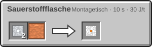
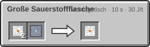
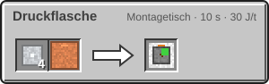

<!-- Erzeugt von tools/gen_wiki.py aus docs/handbook/ und spec/data. Nicht von Hand ändern. -->

[📖 Wiki](README.md) › Phase 2 · Raumfahrtprogramm › **Sauerstoff speichern**

# Sauerstoff speichern

Sauerstoff entsteht im [Elektrolyseur](Elektrolyseur.md) oder im [Sauerstoffgenerator](Sauerstoffgenerator.md). Damit du ihn mitnehmen und lagern kannst, gibt es Flaschen und Druckflaschen.

## Sauerstoffflaschen

| Flasche | Inhalt |
| --- | --- |
| Sauerstoffflasche | 600 mB |
| Große Sauerstoffflasche | 1.200 mB |

- **Füllen:** Leg eine Flasche in den **Füllslot** einer Maschine mit Sauerstofftank, etwa Elektrolyseur, Sauerstoffgenerator oder Druckflasche. Sie füllt sich sofort mit so viel, wie da ist.
- **Leeren:** Im **Leerslot** gibt die Flasche ihren Inhalt in den Tank ab.
- **Unterwegs:** Flaschen im Inventar füllen deinen [Druckanzug](Der-Druckanzug.md) von selbst nach.

Den Inhalt zeigt der Tooltip. Flaschen nehmen nur Sauerstoff.

## Die Druckflasche

Die Druckflasche ist ein Tank nur für Gase und fasst 8.000 mB. Sie hat wie der Fluidtank eine Ausgangsseite und Füll- und Leerslots. Abgebaut behält sie ihren Inhalt.

| Steckbrief: Druckflasche |  |
| --- | --- |
| Speicher | 8.000 mB |

## Herstellung

> [!NOTE]
> Die Flaschen schaltet der Knoten **Druckanzug** frei, die Druckflasche der Knoten **Gasspeicher** (beide Stufe 1, [Forschung](Forschung.md)).

| Rezept | Zutaten → Ergebnis | Wo | Dauer |
| --- | --- | --- | --- |
|  | 2 × [Aluminiumplatte](Presse.md), 1 × [Kupferrohr](Fluide-und-Rohre.md) → 1 × Sauerstoffflasche | Montagetisch | 200 t (10 s) 30 J/t |
|  | 2 × Sauerstoffflasche, 1 × [Titanplatte](Presse.md) → 1 × Große Sauerstoffflasche | Montagetisch | 200 t (10 s) 30 J/t |
|  | 4 × [Aluminiumplatte](Presse.md), 1 × [Kupferrohr](Fluide-und-Rohre.md) → 1 × Druckflasche | Montagetisch | 200 t (10 s) 30 J/t |

> [!TIP]
> Eine Druckflasche neben dem Sauerstoffgenerator sammelt seinen Überschuss. So hast du immer einen Vorrat für neue Flaschen.

---

_Diese Seite steht auch im Spiel im **Ingenieurs-Handbuch**._

← [Der Druckanzug](Der-Druckanzug.md) · [Strom im All](Strom-im-All.md) →
