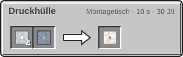
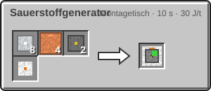

<!-- Erzeugt von tools/gen_wiki.py aus docs/handbook/ und spec/data. Nicht von Hand ändern. -->

[📖 Wiki](README.md) › Phase 3 · Ring 1 › **Sauerstoffgenerator**

# Sauerstoffgenerator

Der Sauerstoffgenerator erzeugt Sauerstoff nur aus Strom. Anders als der Elektrolyseur braucht er kein Wasser und funktioniert deshalb überall, auch auf dem trockenen Mond.

| Steckbrief: Sauerstoffgenerator |  |
| --- | --- |
| Verbrauch | 60 J/t |
| Dauer je Vorgang | 1.200 t (60 s) |
| Tanks | 2.000 mB |
| Upgrade-Slots | 2 |

## So benutzt du ihn

1. Stell den Generator auf und versorge ihn mit Strom.
2. Er erzeugt alle 1.200 t (60 s) 100 mB Sauerstoff in seinen internen Puffer.
3. Über seine **Ausgangsseite** gibt er den Sauerstoff an Tanks, Druckflaschen oder Rohre ab. Die Seite wählst du mit dem Knopf „Seite“.
4. Eine leere [Sauerstoffflasche](Sauerstoff-speichern.md) im **Füllslot** wird sofort gefüllt.

Wie alle Maschinen nimmt er [Upgrades](Upgrades.md).

## Herstellung

Er braucht eine Druckhülle. Die Druckhülle ist ein Bauteil für alles, was unter Druck steht.

4 × [Aluminiumplatte](Presse.md), 1 × [Titanplatte](Presse.md) → 1 × Druckhülle

8 × [Aluminiumplatte](Presse.md), 4 × [Kupferrohr](Fluide-und-Rohre.md), 2 × [Schaltkreis](Montagetisch.md), 1 × Druckhülle → 1 × Sauerstoffgenerator

> [!TIP]
> Der Elektrolyseur liefert Sauerstoff deutlich günstiger, solange du Wasser hast. Auf dem Mond ist der Generator die einfachste Quelle.

---

_Diese Seite steht auch im Spiel im **Ingenieurs-Handbuch**._

← [Erste Schritte auf fremden Welten](Erste-Schritte-auf-fremden-Welten.md) · [Die Kuppel](Die-Kuppel.md) →
