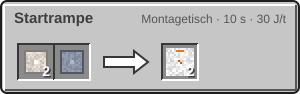
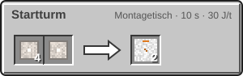
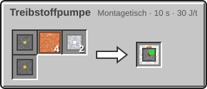
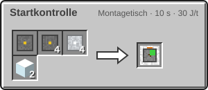
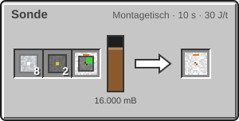

<!-- Erzeugt von tools/gen_wiki.py aus docs/handbook/ und spec/data. Nicht von Hand ändern. -->

[📖 Wiki](README.md) › Phase 2 · Raumfahrtprogramm › **Startrampe und Sonde**

# Startrampe und Sonde

Bevor Menschen fliegen, fliegt eine Sonde. Erst wenn sie ein Ziel erreicht hat, kennt deine Agentur den Weg dorthin, und du kannst mit der [Rakete](Die-Rakete.md) folgen. Beides startet von derselben **Startrampe**.

## Die Startrampe bauen

| Steckbrief: Startrampe |  |
| --- | --- |
| Plattform | 5 × 5 Startrampe |
| Turm | Startturm neben dem Rand, mindestens so hoch wie die Rakete |
| Pumpe | mindestens eine Treibstoffpumpe an Plattform oder Turm |
| Steuerpult | Startkontrolle höchstens 8 Blöcke von der Mitte |

1. **Plattform:** Lege eine Fläche aus Startrampe, 5 × 5 Blöcke auf gleicher Höhe. Ihre Mitte ist der Block, auf dem später das Triebwerk oder die Sonde steht. Weitere Rampenblöcke daneben stören nicht.
2. **Turm:** Stell eine senkrechte Säule Startturm direkt neben den Rand der Fläche, nicht an eine Ecke. Ihr unterster Block steht auf Plattformhöhe. Der Turm muss mindestens so hoch sein wie die Rakete (Flossen zählen nicht), für eine Sonde reicht ein Block.
3. **Pumpe:** Mindestens eine Treibstoffpumpe berührt Plattform oder Turm mit einer Fläche.
4. **Steuerpult:** Setz das Startkontrolle höchstens 8 Blöcke von der Mitte entfernt. Es steuert immer die nächste gültige Rampe.

Das Steuerpult prüft die Rampe, wenn du es öffnest, beim Start und alle 100 t (5 s). Stimmt etwas nicht, leuchtet seine Lampe rot, und die Checkliste nennt den ersten Fehler.

## Betanken

Die Treibstoffpumpe hat zwei Tanks: einen für Brennstoff ([Kerosin](Raffinerie.md)) und einen für Sauerstoff. Sie nimmt von allen Seiten an, aus Rohren, Tanks und einer [Druckflasche](Sauerstoff-speichern.md), und über Füll- und Leerslot auch aus einem [Transporttank](Sauerstoff-speichern.md). Strom braucht sie nicht.

| Steckbrief: Treibstoffpumpe |  |
| --- | --- |
| Energiepuffer | 0 J |
| Tanks | 16.000 mB, 16.000 mB |
| Abgabe | 200 mB/t je Komponente |

Jeden Tick gibt sie von jeder Komponente bis zu 200 mB ab und verteilt sie gleichmäßig auf alle Raketentanks ihrer Rampe. Ein Raketentank fasst je Komponente 16.000 mB.

## Die Sonde

1. Erforsche den Knoten **Mondsonde** ([Forschung](Forschung.md)). Er macht den Mond zum Sondenziel.
2. Setz eine Sonde auf die Mitte der Rampe.
3. Öffne das Steuerpult. Unter „Sonde auf der Rampe“ steht für jedes erforschte Ziel ein Knopf. Ein Klick startet den Countdown von 200 t (10 s).
4. Die Sonde steigt auf und verschwindet. Ihr Flug dauert 1.200 t (60 s) plus 1.200 t (60 s) je Distanzpunkt des Ziels. Er läuft weiter, auch wenn du dich abmeldest.
5. Kommt sie an, bekommen alle Mitglieder eine Nachricht und den Erfolg „Erstes Signal“, und deine Agentur bekommt beim ersten Mal 10 FP. Ab jetzt ist das Ziel ein Raketenziel.

> [!NOTE]
> Eine Sonde kehrt nie zurück. Für jedes Ziel brauchst du eine eigene.

## Herstellung

| Rezept | Zutaten → Ergebnis | Wo | Dauer |
| --- | --- | --- | --- |
|  | 2 × [Eisenplatte](Presse.md), 1 × [Titanplatte](Presse.md) → 2 × Startrampe | Montagetisch | 200 t (10 s) 30 J/t |
|  | 4 × [Eisenstange](Presse.md), 1 × [Eisenplatte](Presse.md) → 2 × Startturm | Montagetisch | 200 t (10 s) 30 J/t |
|  | 1 × [Maschinenrahmen](Erste-Schritte.md), 4 × [Kupferrohr](Fluide-und-Rohre.md), 2 × [Aluminiumplatte](Presse.md), 1 × [Schaltkreis](Montagetisch.md) → 1 × Treibstoffpumpe | Montagetisch | 200 t (10 s) 30 J/t |
|  | 1 × [Maschinenrahmen](Erste-Schritte.md), 4 × [Schaltkreis](Montagetisch.md), 4 × [Aluminiumplatte](Presse.md), 2 × Glas → 1 × Startkontrolle | Montagetisch | 200 t (10 s) 30 J/t |
|  | 8 × [Aluminiumplatte](Presse.md), 2 × [Schaltkreis](Montagetisch.md), 1 × [Solarpanel](Strom-im-All.md), 16.000 mB [Kerosin](Raffinerie.md) → 1 × Sonde | Montagetisch | 200 t (10 s) 30 J/t |

> [!TIP]
> Bau den Turm gleich hoch genug für die größte Rakete deiner Stufe. Dann musst du später nicht umbauen.

---

_Diese Seite steht auch im Spiel im **Ingenieurs-Handbuch**._

← [Strom im All](Strom-im-All.md) · [Die Rakete](Die-Rakete.md) →
