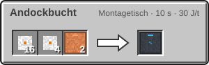
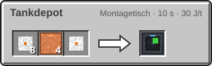
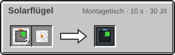
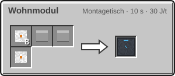
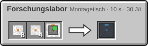
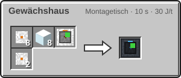

<!-- Erzeugt von tools/gen_wiki.py aus docs/handbook/ und spec/data. Nicht von Hand ändern. -->

[📖 Wiki](README.md) › Phase 4 · Orbit › **Stationsmodule**

# Stationsmodule

Rund um den [Stationskern](Die-Raumstation.md) baust du deine Station mit Modulen aus. Alle Module funktionieren nur im Orbit, das Tankdepot auch überall sonst.

## Andockbucht

Die Andockbucht ist ein Landeplatz für Raketen. Sie erscheint wie ein Landefeuer in der Landeortwahl deiner Agentur und lässt sich mit Rechtsklick benennen. Wählst du sie als Ziel, setzt die Rakete direkt auf ihr auf. Steht eine Rakete auf der Bucht, tankt sie aus angrenzenden Tanks nach, so schnell wie an einer Treibstoffpumpe.

## Tankdepot

Das Tankdepot fasst 256.000 mB eines Fluids. Es gibt nur über seine Ausgangsseite ab, alle anderen Seiten nehmen auf. Neben der Andockbucht ist es der Treibstoffspeicher deiner Station.

| Steckbrief: Tankdepot |  |
| --- | --- |
| Speicher | 256.000 mB |

## Solarflügel

Der Solarflügel liefert im Orbit 20 J/t mal Solarfaktor, solange er die Sonne sieht. Auf einem Planeten liefert er nichts.

## Wohnmodul

Das Wohnmodul ist Bett und Lager zugleich: Rechtsklick setzt deinen Respawnpunkt über das Modul und öffnet 27 Lagerplätze. Der Respawnpunkt gilt nur unter einer aktiven Kuppel.

## Forschungslabor

Ein Analysator direkt neben dem Forschungslabor bringt 1,5-mal so viele Forschungspunkte.

## Gewächshaus

Das Gewächshaus arbeitet wie 9 [Hydrokultur-Becken](Hydrokultur-und-Kompost.md) auf einmal. Es braucht Strom, Wasser, Licht, eine aktive Kuppel und je 6.000 t (300 s) ein [Trockeneis](Der-Mars.md) im letzten Eingabeslot.

## Herstellung

| Rezept | Zutaten → Ergebnis | Wo | Dauer |
| --- | --- | --- | --- |
|  | 16 × [Leichtbau-Platte](Der-Hochtemperaturofen.md), 4 × [Fortgeschrittener Schaltkreis](Der-Hochtemperaturofen.md), 2 × [Kupferrohr](Fluide-und-Rohre.md) → 1 × Andockbucht | Montagetisch | 200 t (10 s) 30 J/t |
|  | 8 × [Leichtbau-Platte](Der-Hochtemperaturofen.md), 4 × [Kupferrohr](Fluide-und-Rohre.md), 1 × [Druckhülle](Sauerstoffgenerator.md) → 1 × Tankdepot | Montagetisch | 200 t (10 s) 30 J/t |
|  | 2 × [Solarpanel](Strom-im-All.md), 1 × [Leichtbau-Platte](Der-Hochtemperaturofen.md) → 1 × Solarflügel | Montagetisch | 200 t (10 s) 30 J/t |
|  | 8 × [Leichtbau-Platte](Der-Hochtemperaturofen.md), 1 × Bett, 1 × Truhe, 1 × [Fortgeschrittener Schaltkreis](Der-Hochtemperaturofen.md) → 1 × Wohnmodul | Montagetisch | 200 t (10 s) 30 J/t |
|  | 8 × [Leichtbau-Platte](Der-Hochtemperaturofen.md), 4 × [Fortgeschrittener Schaltkreis](Der-Hochtemperaturofen.md), 1 × [Analysator](Forschung.md) → 1 × Forschungslabor | Montagetisch | 200 t (10 s) 30 J/t |
|  | 8 × [Leichtbau-Platte](Der-Hochtemperaturofen.md), 8 × Glas, 1 × [Hydrokultur-Becken](Hydrokultur-und-Kompost.md), 2 × [Fortgeschrittener Schaltkreis](Der-Hochtemperaturofen.md) → 1 × Gewächshaus | Montagetisch | 200 t (10 s) 30 J/t |

> [!WARNING]
> Das Wohnmodul setzt den Respawnpunkt nur in einer aktiven Kuppel. Fällt sie aus, erscheinst du nach dem Tod wieder auf der Erde.

> [!TIP]
> Stell ein Tankdepot mit Wasserstoff und Sauerstoff direkt neben die Andockbucht. Dann ist deine Rakete nach jeder Landung schnell wieder voll.

---

_Diese Seite steht auch im Spiel im **Ingenieurs-Handbuch**._

← [Die Raumstation](Die-Raumstation.md)
