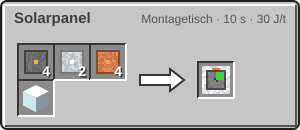
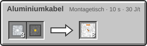

<!-- Erzeugt von tools/gen_wiki.py aus docs/handbook/ und spec/data. Nicht von Hand ändern. -->

[📖 Wiki](README.md) › Phase 2 · Raumfahrtprogramm › **Strom im All**

# Strom im All

Auf dem Mond gibt es weder Kohle noch Kerosin vor der Tür. Das Solarpanel macht Strom aus Sonnenlicht, und das Aluminiumkabel leitet mehr Strom als Kupfer.

## Das Solarpanel

Ein Solarpanel braucht **freien Himmel** über sich. Dann liefert es tagsüber 5 J/t, multipliziert mit dem **Solarfaktor** des Ortes. In der Dämmerung sinkt die Leistung, nachts ist sie 0. Bei Regen bringt es nur noch 25 %.

| Steckbrief: Solarpanel |  |
| --- | --- |
| Energiepuffer | 5.000 J |

| Ort | Solarfaktor |
| --- | --- |
| Erde | 1 |
| Mond | 1 |
| Polarkrater des Mondes | 0 |

Das Panel schiebt seinen Strom in alle angrenzenden Kabel und Maschinen. Sein Puffer reicht für kurze Pausen; für die Nacht brauchst du einen [Akku](Strom.md).

> [!WARNING]
> In den Polarkratern des Mondes kommt kein Sonnenlicht an. Ein Solarpanel liefert dort nichts.

## Das Aluminiumkabel

Ein Aluminiumkabel leitet 2.048 J/t, ein [Kupferkabel](Strom.md) nur 256 J/t. Kabel verschiedener Sorten verbinden sich nicht direkt. Für den Übergang stellst du einen Akku dazwischen.

## Herstellung

4 × [Silizium](Elektroofen.md), 2 × [Aluminiumplatte](Presse.md), 4 × [Kupferdraht](Presse.md), 1 × Glas → 1 × Solarpanel

3 × [Aluminiumdraht](Presse.md), 1 × [Kunststoff](Raffinerie.md) → 8 × Aluminiumkabel

> [!TIP]
> Stell neben jede Mondbasis ein paar Solarpanels und einen Akku. Tagsüber laden sie den Akku, nachts versorgt er Kuppel und Maschinen.

---

_Diese Seite steht auch im Spiel im **Ingenieurs-Handbuch**._

← [Sauerstoff speichern](Sauerstoff-speichern.md) · [Startrampe und Sonde](Startrampe-und-Sonde.md) →
