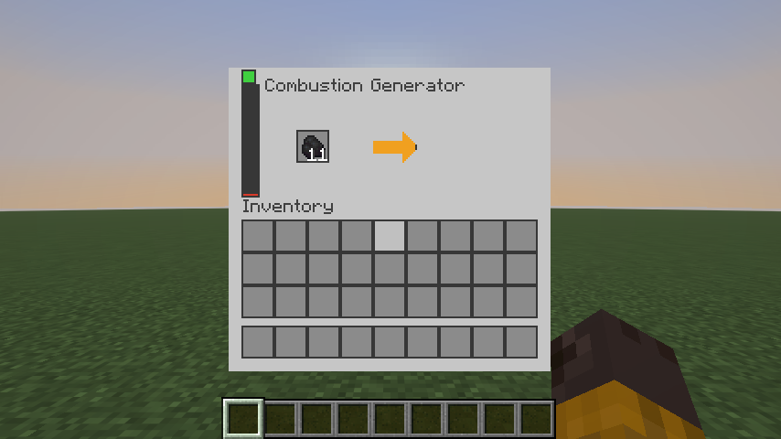
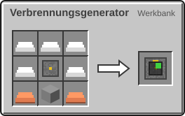
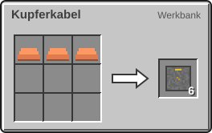

<!-- Erzeugt von tools/gen_wiki.py aus docs/handbook/ und spec/data. Nicht von Hand ändern. -->

[📖 Wiki](README.md) › Phase 1 · Erdindustrie › **Strom**

# Strom

Alle Maschinen laufen mit Strom, gemessen in **Joule (J)**. Wie viel eine Maschine pro Tick braucht, steht als **J/t** auf ihrer Seite. Ein Tick ist eine Zwanzigstelsekunde.

## Verbrennungsgenerator

Der Verbrennungsgenerator ist dein erstes Kraftwerk. Er verbrennt alles, was auch im Ofen brennt, und liefert 20 J/t. Lavaeimer funktionieren auch; der leere Eimer bleibt im Slot liegen.

| Steckbrief: Verbrennungsgenerator |  |
| --- | --- |
| Leistung | 20 J/t |
| Energiepuffer | 20.000 J |
| Brennstoff | alles, was im Ofen brennt (z. B. Kohle: 1.600 t (80 s)) |

Das Fenster des Verbrennungsgenerators: Brennstoffslot und Restbrennzeit.

2 × Kupferbarren, 5 × Eisenbarren, 1 × Ofen, 1 × [Maschinenrahmen](Erste-Schritte.md) → 1 × Verbrennungsgenerator

## Kupferkabel

Das Kupferkabel verbindet sich von selbst mit allem, was Strom erzeugt oder braucht. Ein Kabelnetz überträgt höchstens 256 J/t, egal wie lang es ist. Generatoren schieben ihren Strom in alle Seiten, das Netz verteilt ihn gleichmäßig auf alle Maschinen.

| Steckbrief: Kupferkabel |  |
| --- | --- |
| Durchsatz | 256 J/t |

3 × Kupferbarren → 6 × Kupferkabel

> [!TIP]
> Ein Kupferkabel-Netz trägt 256 J/t. Reicht das nicht, teile deine Maschinen auf mehrere Netze mit eigenem Generator auf.

> [!NOTE]
> Maschinen verbrauchen nur Strom, wenn sie arbeiten. Wird der Strom knapp, pausieren sie und machen später an derselben Stelle weiter. Nichts geht verloren.

---

_Diese Seite steht auch im Spiel im **Ingenieurs-Handbuch**._

← [Rohstoffe und Erze](Rohstoffe-und-Erze.md) · [Zerkleinerer](Zerkleinerer.md) →
