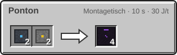

<!-- Erzeugt von tools/gen_wiki.py aus docs/handbook/ und spec/data. Nicht von Hand ändern. -->

[📖 Wiki](README.md) › Phase 5 · Ring 2 › **Titan**

# Titan

Titan hat als einziger Mond eine dichte Atmosphäre. Atmen kannst du sie nicht, aber der Druck ist normal, und es ist -180 °C kalt. Die Schwerkraft beträgt 0,14 g. Ein Druckanzug genügt.

## Gebiete

- **Methanseen**: Bis y 62 sind die Senken mit flüssigem Methan gefüllt.
- **Dünen** aus Titan-Dünensand.
- **Eisgebirge** aus Titan-Eisgestein.

Statt Regen fällt auf Titan **Methanregen**.

## Gleiten

In der dichten Luft sinkst du mit Elytren langsamer (Sinkrate ×0,5). Von einem Eisgebirge kommst du so weit über die Seen.

> [!TIP]
> Spring mit Elytren von einem hohen Gipfel ab. Auf Titan gleitest du ohne Feuerwerk weiter als auf der Erde.

## Der Methanläufer

Auf den Methanseen läuft der **Methanläufer**. Er flieht, sobald du näher als 12 Blöcke kommst. Erlegt gibt er ein Läuferbein.

| Rezept | Zutaten → Ergebnis | Wo | Dauer |
| --- | --- | --- | --- |
|  | 2 × Läuferbein, 2 × [Kunststoff](Raffinerie.md) → 4 × [Ponton](Bohrturm-und-Pumpstation.md) | Montagetisch | 200 t (10 s) 30 J/t |

> [!WARNING]
> Wer in einen Methansee fällt, sinkt wie im Wasser. Halte dich am Ufer und nimm genug Sauerstoff mit.

---

_Diese Seite steht auch im Spiel im **Ingenieurs-Handbuch**._

← [Saturn-Orbit](Saturn-Orbit.md) · [Enceladus](Enceladus.md) →
