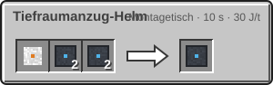
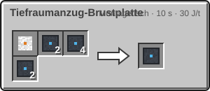
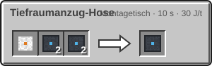
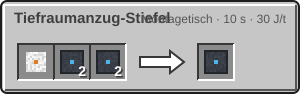
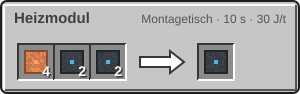

<!-- Erzeugt von tools/gen_wiki.py aus docs/handbook/ und spec/data. Nicht von Hand ändern. -->

[📖 Wiki](README.md) › Phase 5 · Ring 2 › **Triton**

# Triton

Triton ist der kälteste Ort, den du erreichen kannst: -235 °C. Seine dünne Luft kannst du nicht atmen. Die Schwerkraft beträgt 0,08 g.

## Ausrüstung

Hier reicht kein Anzug allein. Du brauchst den [Tiefraumanzug](Der-Tiefraumanzug.md) mit Heizmodul.

> [!WARNING]
> Ohne Heizmodul erfrierst du auf Triton auch im Tiefraumanzug.

## Gebiete

- **Cantaloupe-Terrain**: wellige Hügel aus Triton-Eis.
- **Polkappe** und **Geysirfelder**, beide selten. In den Geysirfeldern stehen Stickstoff-Geysir. Sie lassen sich nicht abbauen.

## Der Frostkriecher

Im Eis lauert der **Frostkriecher**. Er ist unsichtbar, bis du ihm näher als 4 Blöcke kommst; dann bricht er hervor und greift an (7 Schaden). Erlegt lässt er manchmal Isoliergewebe fallen, das Material für den Tiefraumanzug.

| Rezept | Zutaten → Ergebnis | Wo | Dauer |
| --- | --- | --- | --- |
|  | 1 × [Hitzeanzug-Helm](Der-Hitzeanzug.md), 2 × [Supraleiterdraht](Fertigung-im-Orbit.md), 2 × Isoliergewebe → 1 × [Tiefraumanzug-Helm](Der-Tiefraumanzug.md) | Montagetisch | 200 t (10 s) 30 J/t |
|  | 1 × [Hitzeanzug-Brustplatte](Der-Hitzeanzug.md), 2 × [Supraleiterdraht](Fertigung-im-Orbit.md), 4 × [Lithium-Akku](Lithium.md), 2 × Isoliergewebe → 1 × [Tiefraumanzug-Brustplatte](Der-Tiefraumanzug.md) | Montagetisch | 200 t (10 s) 30 J/t |
|  | 1 × [Hitzeanzug-Hose](Der-Hitzeanzug.md), 2 × [Supraleiterdraht](Fertigung-im-Orbit.md), 2 × Isoliergewebe → 1 × [Tiefraumanzug-Hose](Der-Tiefraumanzug.md) | Montagetisch | 200 t (10 s) 30 J/t |
|  | 1 × [Hitzeanzug-Stiefel](Der-Hitzeanzug.md), 2 × [Supraleiterdraht](Fertigung-im-Orbit.md), 2 × Isoliergewebe → 1 × [Tiefraumanzug-Stiefel](Der-Tiefraumanzug.md) | Montagetisch | 200 t (10 s) 30 J/t |
|  | 4 × [Kupferdraht](Presse.md), 2 × [Lithium-Akku](Lithium.md), 2 × Isoliergewebe → 1 × [Heizmodul](Der-Tiefraumanzug.md) | Montagetisch | 200 t (10 s) 30 J/t |

> [!TIP]
> Geh im Dunkeln langsam über das Eis. Bricht ein Frostkriecher hervor, hast du einen Moment Zeit, bevor er dich erreicht.

---

_Diese Seite steht auch im Spiel im **Ingenieurs-Handbuch**._

← [Uranus- und Neptun-Orbit](Uranus-und-Neptun-Orbit.md) · [Der Tiefraumanzug](Der-Tiefraumanzug.md) →
