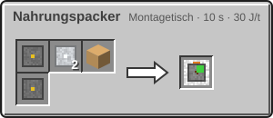

<!-- Erzeugt von tools/gen_wiki.py aus docs/handbook/ und spec/data. Nicht von Hand ändern. -->

[📖 Wiki](README.md) › Phase 2 · Raumfahrtprogramm › **Weltraumnahrung**

# Weltraumnahrung

Auf langen Reisen ist Platz im Inventar knapp. Der Nahrungspacker presst 3 beliebige Nahrungsmittel zu einer Weltraumration. Die Ration sättigt so viel wie alle Zutaten zusammen, höchstens 20 Hungerpunkte und 20 Sättigung. Rationen stapeln sich bis 16.

Den Nahrungspacker schaltet der Forschungsknoten „Raumfahrtnahrung“ frei, siehe [Forschung](Forschung.md).

| Steckbrief: Nahrungspacker |  |
| --- | --- |
| Verbrauch | 10 J/t |
| Dauer je Vorgang | 100 t (5 s) |
| Slots | 3 Eingabe, 1 Ausgabe |
| Upgrade-Slots | 2 |

## So geht's

1. Stell den Nahrungspacker auf und schließ ihn an Strom an.
2. Leg in jeden Eingabeslot ein Nahrungsmittel. Es dürfen verschiedene sein.
3. Nach einem Vorgang liegt die Ration im Ausgabeslot. Der Tooltip zeigt, wie viel sie sättigt.

1 × [Maschinenrahmen](Erste-Schritte.md), 2 × [Aluminiumplatte](Presse.md), 1 × Kolben, 1 × [Schaltkreis](Montagetisch.md) → 1 × Nahrungspacker

> [!TIP]
> Nimm sättigende Zutaten wie Brot, gebackene Kartoffeln oder Steak. Daraus wird eine Ration, die den Hunger fast ganz stillt.

---

_Diese Seite steht auch im Spiel im **Ingenieurs-Handbuch**._

← [Die Rakete](Die-Rakete.md) · [Der Flug](Der-Flug.md) →
