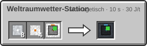

<!-- Erzeugt von tools/gen_wiki.py aus docs/handbook/ und spec/data. Nicht von Hand ändern. -->

[📖 Wiki](README.md) › Phase 4 · Orbit › **Weltraumwetter-Station**

# Weltraumwetter-Station

Die Weltraumwetter-Station beobachtet die Sonne und den Himmel. Solange sie Strom hat, warnt sie alle Mitglieder deiner Agentur in derselben Welt schon 2.400 t (120 s) vor einem Ereignis, statt nur 400 t (20 s) vorher. Sie arbeitet überall außer auf der Erde und braucht einen Besitzer.

| Steckbrief: Weltraumwetter-Station |  |
| --- | --- |
| Verbrauch | 50 J/t |
| Upgrade-Slots | 2 |
| Ort | {"dimension_type": null, "dimensions": [], "excluded_dimensions": ["minecraft:overworld"]} |

8 × [Aluminiumplatte](Presse.md), 4 × [Fortgeschrittener Schaltkreis](Der-Hochtemperaturofen.md), 1 × [Solarpanel](Strom-im-All.md) → 1 × Weltraumwetter-Station

> [!TIP]
> Eine Station je Welt genügt: Die Frühwarnung gilt für die ganze Dimension. Siehe [Weltraumwetter und Ereignisse](Weltraumwetter-und-Ereignisse.md).

---

_Diese Seite steht auch im Spiel im **Ingenieurs-Handbuch**._

← [Fertigung im Orbit](Fertigung-im-Orbit.md)
