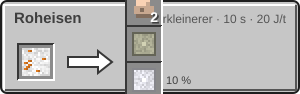

<!-- Erzeugt von tools/gen_wiki.py aus docs/handbook/ und spec/data. Nicht von Hand ändern. -->

[📖 Wiki](README.md) › Phase 3 · Ring 1 › **Weltraumwetter und Ereignisse**

# Weltraumwetter und Ereignisse

Fremde Welten haben ihr eigenes Wetter. Alle 1.200 t (60 s) würfelt der Server für jede Welt mit Spielern, ob ein Ereignis kommt. Es beginnt 2.400 t (120 s) später, und 400 t (20 s) vorher bekommst du eine Warnung im Chat, einen Warnton und eine Anzeige im HUD. Wie oft Ereignisse kommen, stellt der Server mit `event_frequency` ein.

## Sonnensturm

Auf allen Welten außer der Erde. Die Strahlung steigt um 2. Maschinen ohne Dach aus mindestens 3 Blöcken halten alle 200 t (10 s) für 40 t (2 s) an. Dafür liefern Solarpanels das 2-Fache.

## Meteoritenschauer

Auf Mond und Mars. Alle 100 t (5 s) schlägt bei jedem Spieler im Umkreis von 64 Blöcken ein Meteorit ein. Er explodiert ohne Feuer (ob Blöcke zerstört werden, stellt der Server ein) und hinterlässt Meteoritenerz. Im [Zerkleinerer](Zerkleinerer.md) gibt das Eisen, Nickel und mit Glück Rohplatin oder Rohiridium.

1 × Meteoritenerz → 2 × Roheisen, 1 × [Rohnickel](Der-Mars.md), 1 × Rohplatin (10 %), 1 × Rohiridium (5 %)

## Staubsturm (Mars)

Statt Regen ziehen auf dem Mars Staubstürme auf. Solarpanels liefern nur noch das 0,25-Fache, Monster kommen doppelt so oft, und Staubgeister tauchen auf, die dich zu Erkundungszielen führen können (siehe [Kreaturen](Kreaturen-des-inneren-Sonnensystems.md)).

## Säureregen (Venus)

Auf der Venus regnet es Säure. Wer ungeschützt unter freiem Himmel steht, verliert alle 40 t (2 s) Haltbarkeit an Rüstung und Werkzeugen in der Hand. Der [Hitzeanzug](Der-Hitzeanzug.md) schützt dich.

> [!WARNING]
> Stell auf dem Mars und dem Mond keine wertvollen Maschinen ungeschützt unter freien Himmel. Ein Dach aus drei Blöcken schützt sie im Sonnensturm.

> [!TIP]
> Ein Meteoritenschauer ist eine gute Gelegenheit: Sammle die Einschläge ein, solange er dauert.

---

_Diese Seite steht auch im Spiel im **Ingenieurs-Handbuch**._

← [Kreaturen des inneren Sonnensystems](Kreaturen-des-inneren-Sonnensystems.md) · [Hydrokultur und Kompost](Hydrokultur-und-Kompost.md) →
