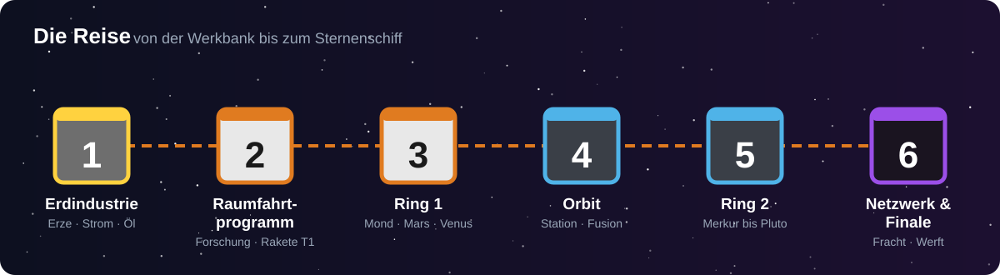

<!-- Erzeugt von tools/gen_wiki.py aus docs/handbook/ und spec/data. Nicht von Hand ändern. -->

[📖 Wiki](README.md) › Willkommen › **Willkommen bei Sternenwerft**

# Willkommen bei Sternenwerft

Willkommen, Ingenieurin, willkommen, Ingenieur! Du stehst am Anfang einer langen Reise: von einer kleinen Werkstatt auf der Erde bis zur **Orbitalwerft**, in der du am Ende das Sternenschiff baust.

Sternenwerft führt dich durch das **echte Sonnensystem**. Jeder Schritt baut auf dem vorigen auf: Erst brauchst du Strom und Maschinen, dann Treibstoff, dann eine Rakete. Auf dem Mond lernst du, ohne Luft zu überleben, auf der Venus, der Hitze zu trotzen, und ganz draußen bei Pluto wartet ein Signal, das niemand erklären kann.

## Die Reise in sechs Phasen

1. **Erdindustrie** – Erze, Strom, Maschinen, Erdöl und Kunststoff.
2. **Raumfahrtprogramm** – Forschung, die erste Sonde, die erste Rakete, der Mond.
3. **Ring 1** – Mond, Mars und Venus, Raumanzug und Kuppeln.
4. **Orbit** – eine eigene Raumstation und Fusionsstrom.
5. **Ring 2** – von Merkur bis Pluto, mit immer härteren Bedingungen.
6. **Netzwerk und Finale** – Frachtraketen zwischen deinen Außenposten und das Sternenschiff.

## So benutzt du dieses Handbuch

- Das Handbuch wächst mit dir: Ein neues Kapitel öffnet sich, sobald du die passende Forschungsstufe erreichst.
- Unterstrichene Begriffe sind **Links**. Ein Klick bringt dich zur passenden Seite.
- Rezepte stehen direkt auf den Seiten der Maschinen. Eine Übersicht findest du unter [Alle Rezepte](Alle-Rezepte.md).
- Neu bei Sternenwerft? Lies zuerst die [Grundbegriffe](Grundbegriffe.md).
- Weißt du nicht weiter, schau in [Erste Schritte](Erste-Schritte.md) oder in die [Tipps und häufigen Fragen](Tipps-und-haeufige-Fragen.md).

> [!TIP]
> Fang mit [Erste Schritte](Erste-Schritte.md) an. Dort steht der ganze Ablauf der ersten Phase Schritt für Schritt.

---

_Diese Seite steht auch im Spiel im **Ingenieurs-Handbuch**._

[Installation](Installation.md) →
