<!-- Erzeugt von tools/gen_wiki.py aus docs/handbook/ und spec/data. Nicht von Hand ändern. -->

[📖 Wiki](README.md) › Phase 1 · Erdindustrie › **Zerkleinerer**

# Zerkleinerer

Der Zerkleinerer ist die erste Maschine, die du bauen solltest. Er mahlt Rohformen von Metallen zu **zwei** Staub. Schmilzt du den Staub, bekommst du aus jedem Erz zwei Barren statt einem.

| Steckbrief: Zerkleinerer |  |
| --- | --- |
| Verbrauch | 20 J/t |
| Dauer je Vorgang | 200 t (10 s) |
| Slots | 1 Eingabe, 4 Ausgabe |
| Upgrade-Slots | 2 |

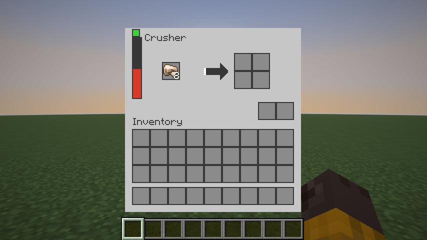

Das Fenster des Zerkleinerers: Energie links, Eingabe, Fortschrittspfeil, vier Ausgabeslots und unten rechts die Upgrade-Slots.

## Bauen

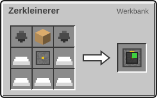

2 × Feuerstein, 5 × Eisenbarren, 1 × [Maschinenrahmen](Erste-Schritte.md), 1 × Kolben → 1 × Zerkleinerer

## Was er verarbeitet

| Rezept | Zutaten → Ergebnis | Wo | Dauer |
| --- | --- | --- | --- |
| 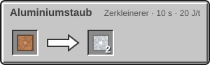 | 1 × [Bauxit](Rohstoffe-und-Erze.md) → 2 × Aluminiumstaub | Zerkleinerer | 200 t (10 s) 20 J/t |
| 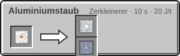 | 1 × [Metallkonzentrat](Kreaturen-des-inneren-Sonnensystems.md) → 1 × Aluminiumstaub, 1 × Titanstaub | Zerkleinerer | 200 t (10 s) 20 J/t |
| 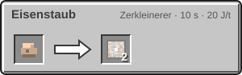 | 1 × Roheisen → 2 × Eisenstaub | Zerkleinerer | 200 t (10 s) 20 J/t |
| 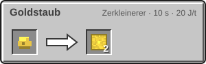 | 1 × Rohgold → 2 × Goldstaub | Zerkleinerer | 200 t (10 s) 20 J/t |
| 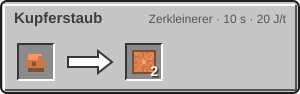 | 1 × Rohkupfer → 2 × Kupferstaub | Zerkleinerer | 200 t (10 s) 20 J/t |
| 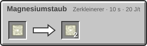 | 1 × [Rohmagnesium](Der-Mars.md) → 2 × [Magnesiumstaub](Der-Mars.md) | Zerkleinerer | 200 t (10 s) 20 J/t |
| 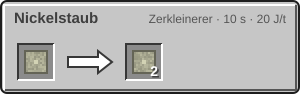 | 1 × [Rohnickel](Der-Mars.md) → 2 × [Nickelstaub](Der-Mars.md) | Zerkleinerer | 200 t (10 s) 20 J/t |
| 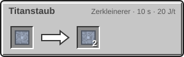 | 1 × [Rohtitan](Rohstoffe-und-Erze.md) → 2 × Titanstaub | Zerkleinerer | 200 t (10 s) 20 J/t |
| 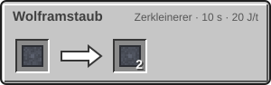 | 1 × [Rohwolfram](Die-Venus.md) → 2 × [Wolframstaub](Die-Venus.md) | Zerkleinerer | 200 t (10 s) 20 J/t |

## Und danach?

Staub schmilzt du im normalen Ofen oder im [Elektroofen](Elektroofen.md):

| Rezept | Zutaten → Ergebnis | Wo | Dauer |
| --- | --- | --- | --- |
|  | 1 × [Bauxit](Rohstoffe-und-Erze.md) → 1 × [Aluminiumbarren](Elektroofen.md) | Ofen oder Elektroofen | – |
| 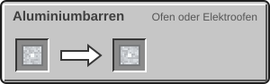 | 1 × Aluminiumstaub → 1 × [Aluminiumbarren](Elektroofen.md) | Ofen oder Elektroofen | – |
| 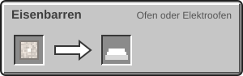 | 1 × Eisenstaub → 1 × Eisenbarren | Ofen oder Elektroofen | – |
| 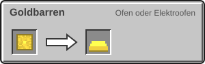 | 1 × Goldstaub → 1 × Goldbarren | Ofen oder Elektroofen | – |
| 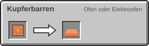 | 1 × Kupferstaub → 1 × Kupferbarren | Ofen oder Elektroofen | – |
|  | 1 × [Rohtitan](Rohstoffe-und-Erze.md) → 1 × [Titanbarren](Elektroofen.md) | Ofen oder Elektroofen | – |
| 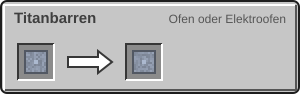 | 1 × Titanstaub → 1 × [Titanbarren](Elektroofen.md) | Ofen oder Elektroofen | – |

> [!TIP]
> Stell einen Trichter auf den Zerkleinerer und einen zweiten darunter in einen Elektroofen. Dann wandert Roherz ganz von selbst zu Barren.

---

_Diese Seite steht auch im Spiel im **Ingenieurs-Handbuch**._

← [Strom](Strom.md) · [Elektroofen](Elektroofen.md) →
